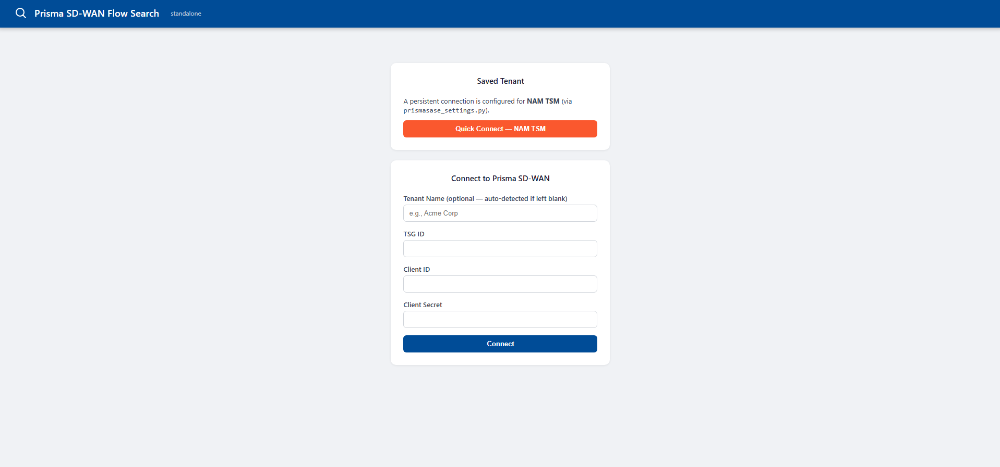
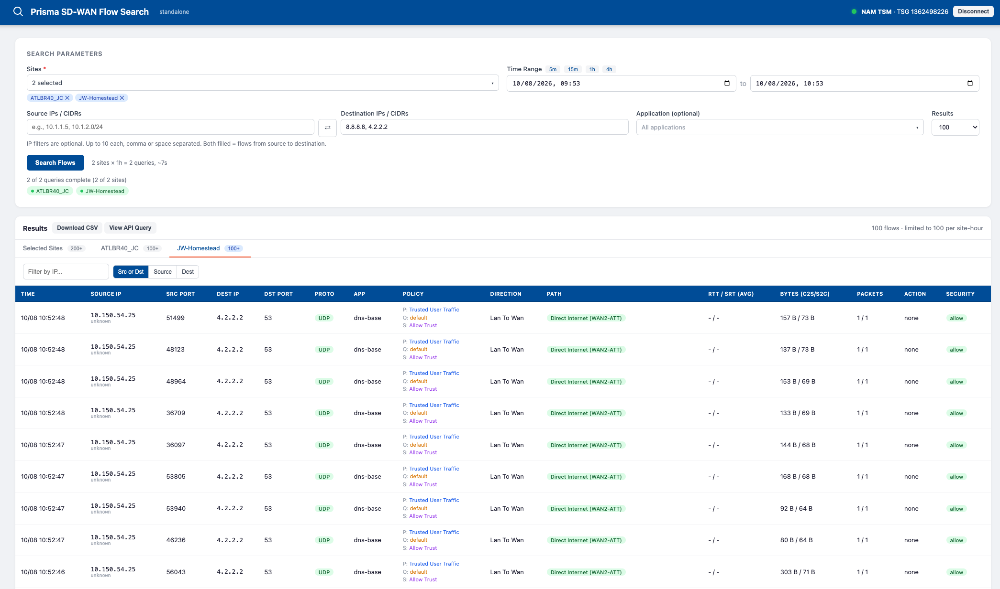

# Prisma SD-WAN Flow Search

A standalone Flask tool for searching Prisma SD-WAN flow records across multiple sites in parallel, with policy name resolution, path names, and CSV/API-query export. Lightweight and single-purpose — clone it, connect, and search, without any other setup.

**Scope note:** this is an individual/personal-use tool, not a multi-user service. It holds one active connection per browser session (no accounts, no per-user isolation), and every server restart invalidates active sessions — that's an intentional tradeoff for simplicity, not an oversight.

---

## Features

- Search flows across multiple sites in parallel, with live per-site progress
- Site / application multi-select with search
- Source and destination IP filters (up to 10 IPs or CIDRs each, comma/space separated; entries within a field are OR'd, the two fields are AND'd), app filter, time range up to 4 hours with quick-select buttons
- Results: sortable columns, per-site tabs, pagination, in-results IP filter
- Path name resolution (not raw path IDs) for anynet, servicelink, and internet-stub links
- Policy name resolution — Path (network), QoS (priority), and Security policy names shown per flow, not raw IDs
- CSV export and a raw API-query-payload viewer (copy/download) for debugging
- Two ways to connect: paste credentials per session (nothing saved), or a persistent "Quick Connect" via a credentials file you manage yourself
- Displays the detected domain (If present) underneath the app-id and can be directly copied via a link that appears to the right of the (www.sample.com) domain display.

---

## Setup

**Python version:** Python 3.11+ is recommended. Older versions may work, but if you run into issues, update to 3.11 or newer.

Clone the repository:

```bash
git clone https://github.com/jswillingham/Prisma-SD-WAN-Flow-Search-App.git
cd Prisma-SD-WAN-Flow-Search-App
```

**With a virtual environment (recommended):**

```bash
python3 -m venv .venv
.venv/bin/pip install -r requirements.txt
.venv/bin/python app.py
```

**Without a virtual environment:**

```bash
pip install -r requirements.txt
python app.py
```

If your system's Python is externally managed (PEP 668 — common on recent Debian/Ubuntu) and this fails with an "externally-managed-environment" error, either use the venv option above, or add `--user` (`pip install --user -r requirements.txt`) or `--break-system-packages` to the install command.

Open http://localhost:5050

## Connecting

**Session-only (default):** paste your TSG ID, Client ID, and Client Secret into the Connect form. Held in server memory for the browser session only — never written to disk.

**Persistent "Quick Connect" (optional):** copy `prismasase_settings.py.example` to `prismasase_settings.py` and fill in your Service Account values:

```bash
cp prismasase_settings.py.example prismasase_settings.py
```

The app only *reads* this file — it never writes it. If present, a "Quick Connect" button appears and the credentials in it are used server-side only; they're never sent back to the browser. Keep this file out of version control (`.gitignore` already excludes it) and restrict its permissions:

```bash
chmod 600 prismasase_settings.py
```

---

## Architecture notes

- All Prisma API calls go through the official [`prisma_sase`](https://github.com/PaloAltoNetworks/prisma-sase-sdk-python) SDK, server-side.
- Each browser session's live SDK connection is held in a server-side registry (`_connections` in `app.py`), keyed by an opaque id in the session cookie — the cookie itself can't hold a live Python object.
- Flow search uses a job/poll pattern (`POST /api/search` → `GET /api/search/status/<job_id>`) so the UI can show real per-site progress instead of one long blocking request.
- Rate-limit handling: Prisma's flow monitor API allows ~2 concurrent requests; searches use a semaphore of 2 with a 300ms stagger, plus the SDK's built-in retry/backoff on 429/502/503/504.
- `monitor_flows` is pinned to API version `v3.10`, not the SDK's default `v3.13`.
- `monitor_flows` silently clamps any window longer than 1 hour to its final hour, so searches are split into hourly windows (one query per site per hour) and the range is capped at 4 hours. Each query takes ~8s and only 2 run concurrently (~3.5s effective), so the form shows a query count/time estimate. A window that returns a full page (`page_size`, max 1000) is flagged as possibly truncated.
- `SECRET_KEY` defaults to a random value generated at process start — every restart invalidates active sessions. That's fine for this tool's single-user scope; set the `SECRET_KEY` env var if you ever need sessions to survive a restart.

---

## Screenshots





---

## Known gaps / not yet built

- No persistent named tenant profiles beyond the single optional `prismasase_settings.py` — adding that would need a real auth layer first, since this app has no login system of its own.
